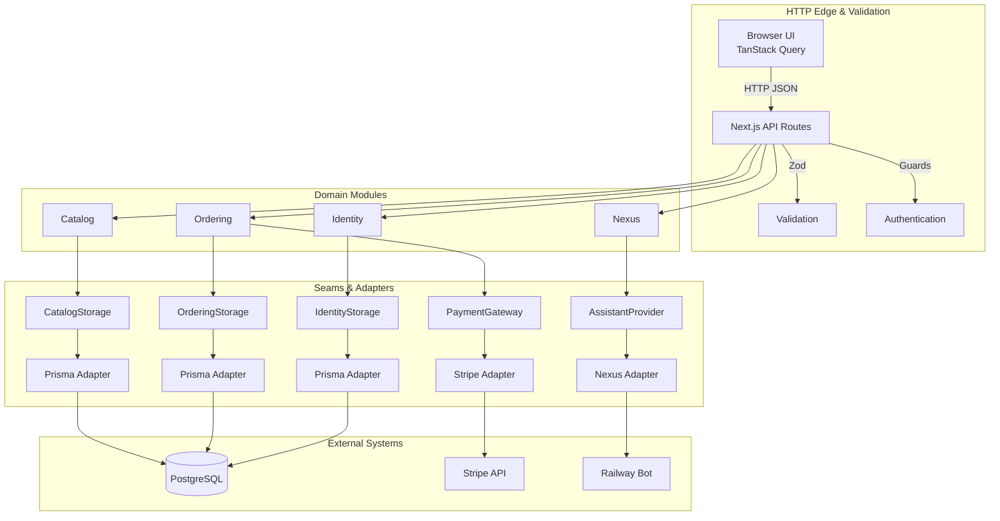

# Kickskraze

A high-concurrency sneaker marketplace built with Next.js 16, Supabase, PostgreSQL, and Stripe. Engineered around **Deep Module Architecture** to keep business domains separate from HTTP adapters, and hardened with **transactional stock reservation** to prevent overselling during high-demand drops.

---

## Highlights

- **Atomic stock reservation** — stock is locked and decremented inside a PostgreSQL transaction at checkout, with automatic release on Stripe session expiry. No overselling.
- **Deep Module Architecture** — `catalog`, `ordering`, `identity`, and `nexus` domains behind explicit storage seams; HTTP handlers never touch Prisma directly.
- **Optimistic cart** — TanStack Query `onMutate` updates with automated rollback on failure.
- **Admin RBAC** — role-based access with self-demotion guards and order management queues.
- **AI assistant** — storefront assistant backed by an external Nexus bot (resilient Groq/Ollama LLM chain + ChromaDB RAG), with a catalog-search fallback when no product is selected.

---

## Architecture



### Deep Modules

| Module | Responsibilities | Seams |
|--------|------------------|-------|
| **Catalog** | Product search, variants, inventory, stock adjustments | `CatalogStorage` → `PrismaCatalogAdapter` |
| **Ordering** | Cart, checkout, order fulfillment, metrics | `OrderingStorage` → `PrismaOrderingAdapter`<br/>`PaymentGateway` → `StripePaymentAdapter` |
| **Identity** | Users, roles, address book | `IdentityStorage` → `PrismaIdentityAdapter` |
| **Nexus** | AI shopping assistant | `AssistantProvider` → `RemoteNexusAdapter` |

---

## Tech Stack

| Layer | Technology |
|-------|------------|
| **Framework** | Next.js 16 (App Router) |
| **Language** | TypeScript (Strict) |
| **Database** | PostgreSQL (Supabase) |
| **ORM** | Prisma 5.22 |
| **Auth** | Supabase Auth |
| **Payments** | Stripe Checkout & Webhooks |
| **Client State** | TanStack Query v5 |
| **Styling** | Tailwind CSS 4 |
| **Validation** | Zod |
| **AI** | Nexus Bot (FastAPI + resilient Groq/Ollama chain + ChromaDB RAG) |

---

## Local Setup

```bash
npm install
cp .env.example .env.local      # Supabase, database, and Stripe test keys
npx prisma db push && npm run seed
npm run make-admin your-email@example.com
npm run dev
# separate terminal
stripe listen --forward-to localhost:3000/api/webhooks/stripe
```

The assistant talks to the Nexus bot over HTTP. Set `NEXUS_BOT_URL` and `NEXUS_BOT_API_KEY` in `.env.local`, or leave them empty to use the built-in mock.

```bash
npm run dev          # development server
npm run build        # production build
npm run lint         # ESLint
npm run typecheck    # TypeScript check
npm run seed         # seed sample data
npm run make-admin   # promote user to admin
```

---

## Live Demo

🔗 **[View Live Site](https://kickskraze-lemon.vercel.app)**

**Test credentials:** Stripe test card `4242 4242 4242 4242` (any future date, any CVC). Create an account to explore user features; contact for admin demo access.
