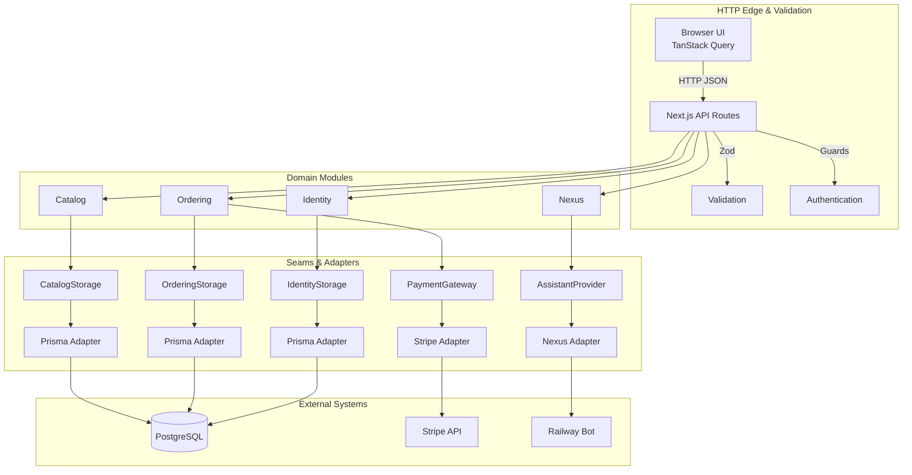
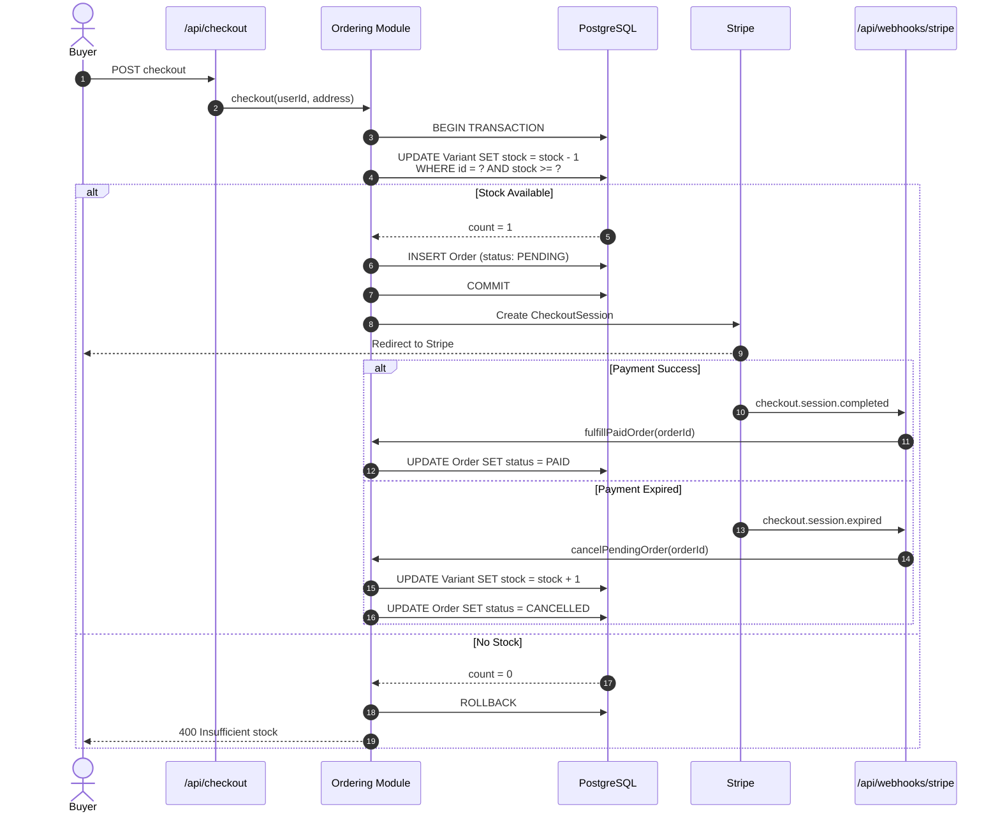

# Kickskraze

A high-concurrency sneaker marketplace built with Next.js 16, Supabase, PostgreSQL, and Stripe. Engineered around **Deep Module Architecture** to strictly separate business domains from HTTP adapters, and hardened with **transactional stock reservation** to prevent inventory race conditions during high-demand product drops.

---

## Technical Highlights

- **Atomic Stock Reservation:** Eliminates overselling race conditions by locking and decrementing stock within a PostgreSQL transaction at checkout initiation, with automated release on Stripe session expiration.
- **Deep Module Architecture:** Domain logic in `catalog`, `ordering`, `identity`, and `nexus` modules behind explicit storage seams. HTTP handlers never import Prisma directly.
- **Optimistic Cart UI:** TanStack Query `onMutate` optimistic updates provide instant UI feedback with automated rollback on failure.
- **Efficient Queries:** PostgreSQL composite indexes enable fast order queries by status, user, and date for admin dashboard metrics.
- **Admin RBAC:** Role-based access control with self-demotion guards and order management queues.
- **AI Assistant:** Shopping assistant powered by external Nexus bot service (Groq LLM + ChromaDB RAG).

---

## Architecture



### Deep Modules

| Module | Responsibilities | Seams |
|--------|------------------|-------|
| **Catalog** | Product search, variants, inventory, stock adjustments | `CatalogStorage` → `PrismaCatalogAdapter` |
| **Ordering** | Cart, checkout, order fulfillment, metrics | `OrderingStorage` → `PrismaOrderingAdapter`<br/>`PaymentGateway` → `StripePaymentAdapter` |
| **Identity** | Users, roles, address book | `IdentityStorage` → `PrismaIdentityAdapter` |
| **Nexus** | AI shopping assistant | `AssistantProvider` → `RemoteNexusAdapter` |

---

## Atomic Stock Reservation

Kickskraze prevents overselling during high-demand drops by reserving stock atomically during checkout:



---

## Tech Stack

| Layer | Technology |
|-------|------------|
| **Framework** | Next.js 16 (App Router) |
| **Language** | TypeScript (Strict) |
| **Database** | PostgreSQL (Supabase) |
| **ORM** | Prisma 5.22 |
| **Auth** | Supabase Auth |
| **Payments** | Stripe Checkout & Webhooks |
| **Client State** | TanStack Query v5 |
| **Styling** | Tailwind CSS 4 |
| **Validation** | Zod |
| **AI** | Nexus Bot (FastAPI + Groq LLM + ChromaDB) |

---

## Project Structure

```
src/
├── app/
│   ├── (shop)/          # Storefront (products, cart, checkout)
│   ├── (user)/          # Customer account (profile, addresses, orders)
│   ├── admin/           # Console (metrics, products, inventory, orders, users)
│   └── api/             # HTTP routes (auth + validation + module call)
├── components/          # UI primitives (assistant, cart, layout, products)
├── hooks/               # React hooks (useCart, useProducts)
├── lib/                 # Utilities (auth, validation, clients)
└── modules/             # Domain modules (catalog, ordering, identity, nexus)
```

---

## Local Setup

### Prerequisites
- Node.js 20+
- PostgreSQL (Supabase)
- Stripe account (test mode)

### Installation
```bash
# 1. Install dependencies
npm install

# 2. Configure .env.local
cp .env.example .env.local
# Add your Supabase, database, and Stripe test keys

# 3. Setup database
npx prisma db push
npm run seed

# 4. Create admin user
npm run make-admin your-email@example.com

# 5. Run dev server
npm run dev

# 6. Forward Stripe webhooks (separate terminal)
stripe listen --forward-to localhost:3000/api/webhooks/stripe
```

Visit [http://localhost:3000](http://localhost:3000)

---

## Available Scripts

```bash
npm run dev          # Development server
npm run build        # Production build
npm run lint         # ESLint
npm run typecheck    # TypeScript check
npm run seed         # Seed sample data
npm run make-admin   # Promote user to admin
```

---

## Live Demo

🔗 **[View Live Site](https://kickskraze-lemon.vercel.app)**

**Test Credentials:**
- Use Stripe test card: `4242 4242 4242 4242` (any future date, any CVC)
- Create an account to explore user features
- Contact for admin demo access
